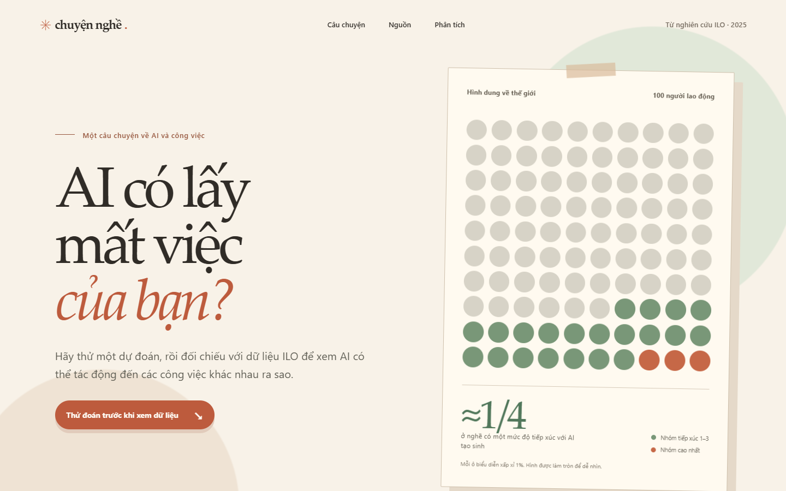

# AI có lấy mất việc của bạn?

[Xem trang scrollytelling](https://tridpt.github.io/ilo-genai-job-exposure/) · [Xem case study phân tích dữ liệu](https://tridpt.github.io/ilo-genai-job-exposure/case-study.html)

Một trang scrollytelling tiếng Việt dựng lại số liệu từ nghiên cứu ILO năm 2025, trình bày theo phong cách bài báo minh họa. Trước khi đọc, người xem có thể dự đoán tỷ lệ việc làm tiếp xúc với AI tạo sinh ở nước thu nhập cao: kéo thanh để tô sáng lưới 100 lao động, xem câu trả lời rồi so sánh với ước tính 34% của ILO. Dự đoán cũng xuất hiện lại trên biểu đồ thu nhập ở chương 3; trục biểu đồ tự mở rộng đến 40%, 60%, 80% hoặc 100% để đặt dự đoán và số liệu ILO trên cùng một thang đo. Năm chương có đồ họa cố định thay đổi theo cuộn: lưới 100 người lao động, phổ mức tiếp xúc, so sánh nhóm nước theo thu nhập, so sánh theo giới có nút chuyển phạm vi, và sơ đồ phương pháp nghiên cứu. Phần cuối so sánh điểm nhiệm vụ của sáu nghề cụ thể.



## Chạy

Mở `index.html` bằng trình duyệt, hoặc chạy máy chủ tĩnh:

```powershell
python -m http.server 8000
```

Sau đó mở `http://localhost:8000`. Trang dùng HTML, CSS và JavaScript thuần. `styles.css` giữ bố cục và các biểu đồ; `editorial.css` định nghĩa lớp giao diện tạp chí. Trang [phân tích dữ liệu](case-study.html) giải thích quy trình phía sau câu chuyện.

## Quy trình phân tích có thể chạy lại

[`CASE_STUDY.md`](CASE_STUDY.md) ghi rõ câu hỏi, mẫu số, phép tính, kiểm tra chất lượng và giới hạn. Dữ liệu cấp nghề được trích từ toàn bộ bảng A1 của ILO Working Paper 140; dữ liệu nhiệm vụ từ JSON công khai được bài báo liên kết. Hai nguồn được đối chiếu bằng mã ISCO-08. Các truy vấn trong [`analysis/queries.sql`](analysis/queries.sql) chạy qua SQLite và tạo đầu vào cho biểu đồ.

```powershell
python -m pip install -r requirements-analysis.txt
python analysis/extract_table_a1.py --check
python analysis/extract_task_tree.py --check
python analysis/build_data.py --check
```

Hai lệnh đầu kiểm tra CSV đã lưu với nguồn ILO trên mạng. Lệnh cuối chạy offline, kiểm tra dữ liệu và bảo đảm `data/story-data.js` đang khớp đầu vào. Để tạo lại đầu ra sau khi sửa CSV, chạy `python analysis/build_data.py`.

## Nguồn và cách hiểu

| Số liệu trên trang | Nguồn |
| --- | --- |
| 20,5% việc làm ở nhóm tiếp xúc 1–3; 3,3% ở nhóm 4 | [ILO Research Brief, trang 7–8](https://www.ilo.org/sites/default/files/2025-05/Research%20brief_FINAL_15May2025_21.05.25_1.pdf) |
| 11% ở nước thu nhập thấp; 34% ở nước thu nhập cao | ILO Research Brief, trang 7 |
| Nhóm 4: nữ 4,7%, nam 2,4% trên toàn cầu; nữ 9,6%, nam 3,5% ở nước thu nhập cao | [ILO Working Paper 140](https://www.ilo.org/publications/generative-ai-and-jobs-refined-global-index-occupational-exposure) |
| 29.753 nhiệm vụ và 112 nhóm nghề trong bốn mức tiếp xúc | ILO Working Paper 140 và ILO Research Brief, trang 7 |
| Điểm nhiệm vụ của sáu nghề được chọn | [ILO Working Paper 140, Phụ lục 1, bảng A1](https://www.ilo.org/sites/default/files/2025-05/WP140_web.pdf) |
| 3.265 mục nhiệm vụ ISCO-08 dùng để đối chiếu điểm nghề | [JSON công khai được Working Paper liên kết, trang 37](https://pgmyrek.github.io/2025_GenAI_scores_ISCO08/output_data.json) |

Tổng 23,8% và phần ngoài bốn nhóm 76,2% được tính từ 20,5% + 3,3%. Lưới 100 ô làm tròn thành 21 ô mức 1–3 và 3 ô mức 4. Các tỷ lệ là **tiềm năng tiếp xúc của nghề** với AI tạo sinh theo chỉ số ILO; chúng không đo số việc làm thực tế bị mất. Điểm nghề 0–1 cũng không phải xác suất mất việc. Bảng A1 có 427 mã nghề, trong đó 112 mã ở nhóm 1–4; tỷ lệ mã nghề không phải tỷ lệ người lao động. Phép đối chiếu điểm nhiệm vụ khớp trong sai số 0,01 ở 426/427 nghề; ngoại lệ được ghi trong case study.

## Kiểm tra

Nếu máy có Playwright và Microsoft Edge, chạy `python smoke_test.py`. Bài kiểm tra duyệt phần dự đoán, dấu dự đoán trong chương 3 và cả năm biểu đồ trên desktop, mobile và màn hình hẹp 320 px; kiểm tra nút chuyển phạm vi, lỗi JavaScript và tràn ngang. Ảnh chụp được lưu trong `docs/`.
